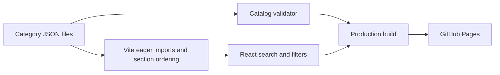

# Security Attack Catalog

[](https://github.com/sayedrisat/security-attack-catalog/actions/workflows/ci.yml)
[](https://github.com/sayedrisat/security-attack-catalog/actions/workflows/deploy.yml)

A community-driven catalog of web, API, cloud, and infrastructure attacks with clear explanations and practical prevention guidance. Each entry can be improved through a reviewed contribution.

**Live site:** https://sayedrisat.github.io/security-attack-catalog/

Started by [Sayed Risat](https://github.com/sayedrisat). Contributions are reviewed through pull requests.

For project vulnerabilities, use [private vulnerability reporting](SECURITY.md). For catalog corrections, use the public [correction form](https://github.com/sayedrisat/security-attack-catalog/issues/new?template=correction.yml). Contributors agree to the [Code of Conduct](CODE_OF_CONDUCT.md).

## Current coverage

- 589 entries in 36 sections
- 208 entries with prevention guidance (35.3%)
- 381 entries open for prevention contributions

The site lets readers search by attack, section, description, tool, or prevention; filter by section; and show entries that still need prevention guidance. It follows the system light or dark setting unless a visitor chooses a theme.

## Architecture and validation



[`scripts/validate-catalog.mjs`](scripts/validate-catalog.mjs) checks section identities and ordering, file names, duplicate entries within a section, required text, and prevention-field structure. [`src/data/catalog.js`](src/data/catalog.js) assembles the sections for [`src/App.jsx`](src/App.jsx). There is no database, login flow, or external API requirement.

`npm run check` validates data structure; it does not independently establish the accuracy of a security claim. Review sources and the affected stack when adding prevention advice. `npm run build` includes the data validator before bundling the site. `npm test` exercises the existing validator against isolated valid/invalid fixtures: coverage reporting, duplicate names, missing prevention fields, malformed JSON, filename identities, and forbidden legacy ratings. It does not edit the real catalog. Automated browser interaction tests are not currently configured.

## Contribute

You can propose a [new attack](https://github.com/sayedrisat/security-attack-catalog/issues/new?template=new-attack.yml), [prevention guidance](https://github.com/sayedrisat/security-attack-catalog/issues/new?template=prevention.yml), or a [correction](https://github.com/sayedrisat/security-attack-catalog/issues/new?template=correction.yml). A pull request with the data change is welcome too. Read [CONTRIBUTING.md](CONTRIBUTING.md) for the file format and review criteria.

Catalog data lives in [`src/data/categories/`](src/data/categories/), one JSON file per section. This keeps most contributions focused on one file. A new attack has this shape:

```json
{
  "name": "Example attack name",
  "notes": "Optional short technical context",
  "desc": "A precise explanation of the weakness and what makes it possible.",
  "prevention": null
}
```

Replace `null` with specific prevention guidance when you can support it. New or changed security claims should include a reliable source in the pull request, preferably official documentation, a standard, or original research. Existing entries may overlap; check the catalog before adding another.

## Run locally

Requires Node.js 24 or newer.

```bash
npm ci
npm run dev
```

Run `npm test` for validator regression tests, `npm run check` to validate the real catalog, and `npm run build` to create the production site in `dist/`. No test dependency or environment secret is required.

## Deployment

The site uses React and Vite. GitHub Actions builds and deploys `dist/` to GitHub Pages after a change lands on `main`. Vite uses `/security-attack-catalog/` as its production base path on Pages. Pull requests run validator regression tests, real-catalog validation and a production build before merge.

For a local build with the same base path as Pages, run `GITHUB_PAGES=true npm run build`. Ordinary local hosting uses `npm run build`. No API keys or runtime secrets are required; `GITHUB_PAGES` only selects Vite's asset base path.

## Scope and safety

This is an educational and defensive reference, not a target list or authorization to test a system. Prevention advice is context dependent and should be checked against your stack and threat model. Report errors through the correction form so the community can improve the catalog.

Code and catalog text are available under the [MIT License](LICENSE).
